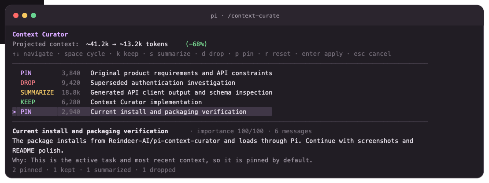
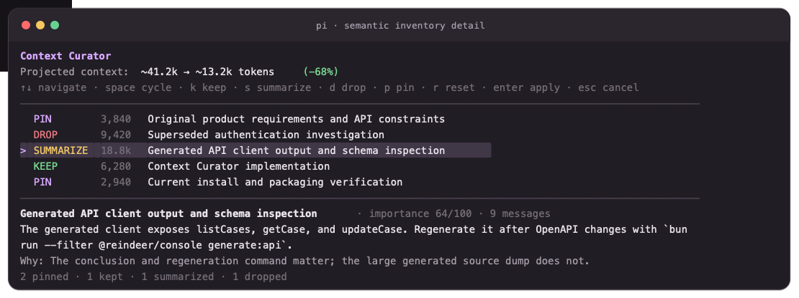

# pi-context-curator

Human-in-the-loop semantic context management for the [Pi coding agent](https://pi.dev).

Instead of replacing an old conversation prefix with one automatic summary, Context Curator builds an inventory of the active context and lets you decide what should remain visible to the model.

## Status

Curation is disruptive to the active provider context: dropped blocks are absent and summarized blocks are replaced on every subsequent model request. It remains reversible because the original Pi session stays in its append-only JSONL history.

## Install

Install and register the extension with Pi:

```bash
pi install git:git@github.com:Reindeer-AI/pi-context-curator.git
```

Then restart Pi or run `/reload`. Confirm registration with `pi list`.

A local checkout can be registered instead:

```bash
pi install /absolute/path/to/pi-context-curator
```

Try a local checkout for one run without registering it:

```bash
pi -e /absolute/path/to/pi-context-curator
```

The repository ships TypeScript source directly. `npm install` alone adds it to the current npm project but does not register it with Pi.

## Usage

```text
/context-curate          Build a fresh semantic inventory and open the curator
/context-curate edit     Edit the existing inventory without another model call
/context-curate status   Show the active projection and estimated savings
/context-curate reset    Restore the full active context
/context-curate help     Show command help
/compact                 Finalize an active projection into native context
```

Without an active projection, `/compact` opens Context Curator. With one active, `/compact` materializes its retained blocks and summaries into a native Pi compaction, disables the request-time projection, and keeps later turns verbatim. At the automatic threshold, native compaction is postponed once so there is an opportunity to run `/context-curate`; an active projection is finalized automatically if native compaction becomes necessary.

## Screenshots

Semantic inventory overview using sample context:



Selected summary detail and rationale:



Regenerate both images from the actual TUI renderer with `npm run screenshots`.

## Curator actions

| Action | Effect |
| --- | --- |
| `PIN` | Keep the block verbatim and protect that choice from future inventory recommendations until you explicitly change it. |
| `KEEP` | Keep the block verbatim for this projection, but let a fresh future inventory recommend another action. |
| `SUMMARIZE` | Replace the block in outgoing model context with its semantic summary and a recall reference. |
| `DROP` | Remove the block from outgoing model context. |

Inside the curator:

```text
↑/↓     navigate
Space   cycle action
k       keep
s       summarize
d       drop
p       pin
r       reset model recommendations
Enter   apply
Esc     cancel
```

## Recall

Summarized blocks contain a stable block ID. The model can use the `context_recall` tool to recover exact original content:

```json
{
  "block_id": "user:1712345678:abcdef123456",
  "offset": 0,
  "limit": 20000
}
```

The source session remains append-only, but the active model context is replaced by the curated projection. Reset and recall are possible because the original entries remain in session history.

## How it works

1. Split the active Pi context into user-turn blocks, keeping assistant/tool sequences atomic.
2. Ask the active model for a structured semantic inventory: title, continuation-quality summary, importance, suggested action, and rationale.
3. Present every block in a full-screen TUI with projected token savings.
4. Persist the selected plan as a Pi custom session entry.
5. Apply the plan through Pi's `context` event before each provider request.
6. Leave future, uncatalogued turns visible by default.
7. Build later inventories from the current curated projection, so dropped material stays hidden and summarized material stays summarized.
8. Optionally finalize the projection with `/compact`, replacing request-time filtering with a native Pi compaction checkpoint.

The latest block is always recommended as `PIN`. A fresh `/context-curate` may reconsider blocks marked `KEEP`, while `PIN` remains pinned. `/context-curate edit` preserves every current action exactly. If semantic analysis fails or no model credentials are available, the extension falls back to conservative deterministic recommendations.

## Guarantees

- Session entries remain append-only; `/context-curate reset` restores the raw projection.
- User-turn/tool chains stay atomic, avoiding orphaned tool calls.
- New turns default to `KEEP`, and re-curation preserves hidden `DROP` decisions.
- Projection changes only when a plan is applied, keeping request prefixes stable.
- Native compaction finalizes an active projection instead of reintroducing its dropped blocks; invalid inventory output uses conservative defaults.

## Configuration

Optional environment variables:

| Variable | Default | Purpose |
| --- | ---: | --- |
| `PI_CONTEXT_CURATOR_ANALYSIS_MAX_CHARS` | `180000` | Maximum source characters budgeted across inventory blocks. |
| `PI_CONTEXT_CURATOR_BLOCK_MAX_CHARS` | `12000` | Maximum characters sampled from one block for inventory analysis. |

## Known limitations

- Token counts are estimates for conversation messages and exclude provider-specific system/tool-schema overhead.
- Blocks are user-turn based; topic clustering across multiple turns is not currently supported.
- The semantic inventory covers conversation messages, not the system prompt or active tool schemas.
- A native compaction can make very old raw content unavailable to the active context builder, although it remains in the session history when recoverable from entries.
- Multiple extensions that transform Pi's `context` event are order-dependent.
- Semantic inventory generation sends sampled active context to the selected model.

## Development

```bash
npm install
npm run verify
```

The package is loaded directly from TypeScript; no build step is required.

## Prior art

Related work includes [pi-smart-compact](https://pi.dev/packages/pi-smart-compact), [pi-condense](https://pi.dev/packages/pi-condense), and [OpenCode Dynamic Context Pruning](https://github.com/Opencode-DCP/opencode-dynamic-context-pruning). Context Curator focuses on semantic, human-reviewed, reversible, non-contiguous context projection.

## License

MIT
